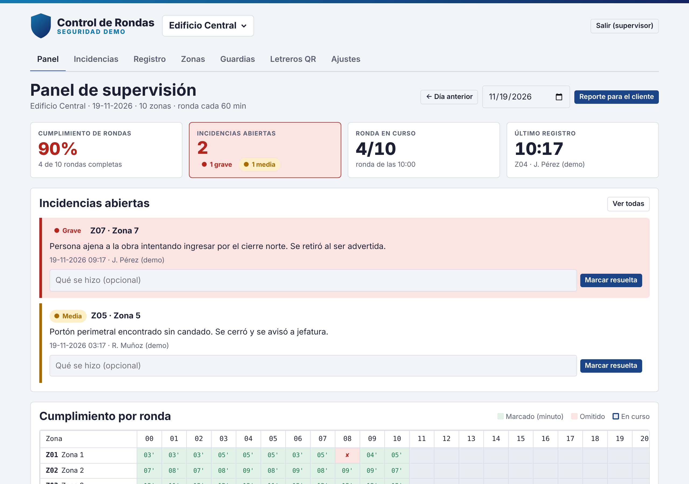
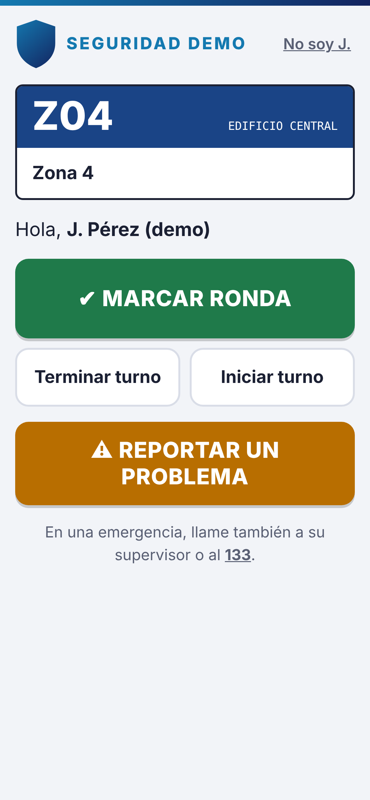
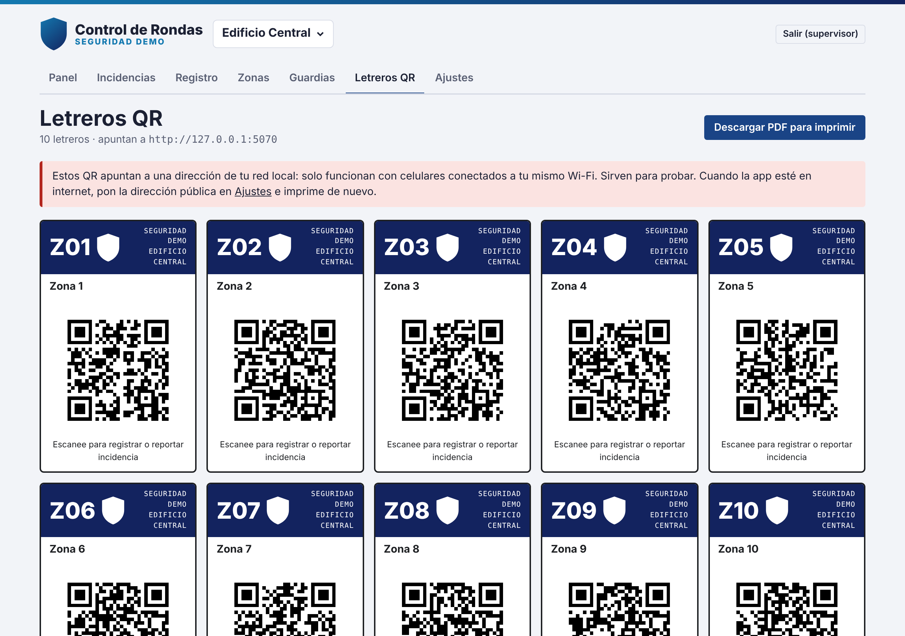
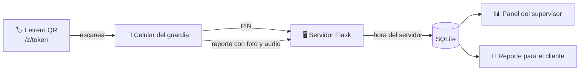

# 🛡️ Control de Rondas: app web para guardias de seguridad

App web que controla las rondas de guardias con **códigos QR**. Cada zona de un recinto tiene un letrero con QR; el guardia lo escanea con su celular, se identifica con su PIN y marca su ronda, su inicio o su fin de turno. También puede **reportar un problema** con foto y audio. El supervisor ve todo en un panel en tiempo real y puede sacar un reporte para el cliente.

> Proyecto real que desarrollé y mantengo para una **empresa de seguridad privada en Chile**, donde ya está en producción. Este repositorio es una **vitrina**: el código es privado, y las capturas son de una instalación de prueba con datos inventados (sin el nombre ni el logo de la empresa).
>
> Hecho por **Joaquin Chandia** ([@Wikzeed](https://github.com/Wikzeed)), estudiante de Ingeniería en Redes y Telecomunicaciones.

  

  
  &nbsp;&nbsp;
  

## El problema

Las rondas se controlaban en papel: no había forma de saber si el guardia realmente pasó por cada punto ni a qué hora, y los problemas llegaban tarde al supervisor. La app tenía que ser **muy fácil de usar** (muchos guardias son personas mayores), funcionar con el celular de cada uno **sin instalar nada** y ser **difícil de engañar**.

## Qué hace

| | |
|---|---|
| 📱 **Pantalla del guardia** | Se abre al escanear el QR, sin instalar nada (también se puede agregar a la pantalla de inicio como app). Botones grandes y pocas palabras: **Marcar ronda**, inicio o fin de turno, y **Reportar un problema** guiado con gravedad (leve, media, grave), foto y audio. |
| 📊 **Panel del supervisor** | Cumplimiento del día, incidencias abiertas (las graves destacadas), ronda en curso y una grilla zona × ronda (verde = marcada, rojo = omitida). |
| 🏢 **Varios recintos** | Cada sitio tiene sus zonas, QR, horario, frecuencia de ronda, registros e incidencias. El menú avisa si otro sitio tiene una incidencia grave abierta. |
| 🧾 **Reporte para el cliente** | Cumplimiento, turnos e incidencias del día, para imprimir o guardar en PDF. Descarga de registros a Excel (CSV) por rango de fechas. |
| 🖨️ **Letreros QR** | Se generan e imprimen desde la app (PDF, 4 por hoja). |
| 👥 **Cuentas** | Roles de jefe y supervisor; guardias con PIN propio. |

## Seguridad

- **QR con token secreto:** cada letrero apunta a `/z/<token>` (aleatorio), no a "Z03": no se puede marcar una zona sin estar frente al letrero. Si un letrero se pierde o lo fotografían, **Nuevo QR** invalida el anterior.
- **La hora la pone el servidor**, no el celular, así que no se puede adelantar ni atrasar.
- **PIN por guardia**, guardado como HMAC con la clave secreta (no en texto). Tras 5 PIN incorrectos, bloqueo de 10 minutos por IP.
- Registros repetidos en menos de 2 minutos cuentan como uno; el guardia puede anular su propio registro en ese plazo.
- Supervisores con contraseña cifrada (hash) y bloqueo tras 5 intentos fallidos.
- Protección **CSRF** en todos los formularios, cookies `HttpOnly`/`Secure`, y cabeceras de seguridad: CSP, `X-Frame-Options`, `Permissions-Policy` (cámara y micrófono solo para la app, ubicación nunca).
- Fotos y audios solo visibles con sesión de supervisor; se aceptan solo imágenes válidas y de tamaño limitado.
- Respaldo diario automático de la base de datos. La base, las fotos y la clave secreta nunca van a git.

## Cómo funciona

## Muestras de código

- [`muestras/marcar_zona.py`](muestras/marcar_zona.py): cómo se marca una zona (token del QR, PIN con HMAC, hora del servidor y registros repetidos). Se puede correr solo.
- [`muestras/seguridad.py`](muestras/seguridad.py): CSRF, roles, límite de intentos y cabeceras de seguridad.

## Tecnologías

Python · Flask · SQLite · Waitress · ReportLab (PDF) · Pillow · JavaScript (escáner de QR con jsQR, grabación de audio, PWA con *service worker*) · HTML/CSS.

## Próximos pasos

- Marcar zonas también con **etiquetas NFC** (acercar el celular en vez de escanear).
- Dominio propio de la empresa y avisos al supervisor por mensaje cuando llega una incidencia grave.
